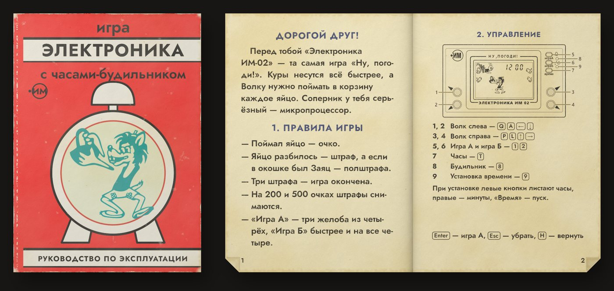
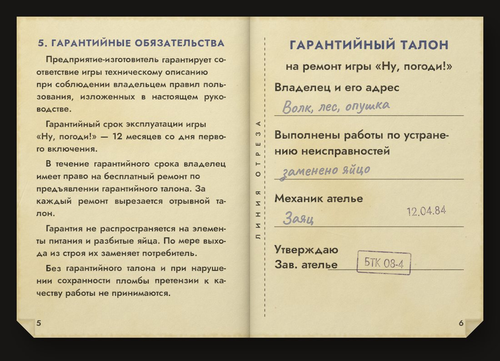
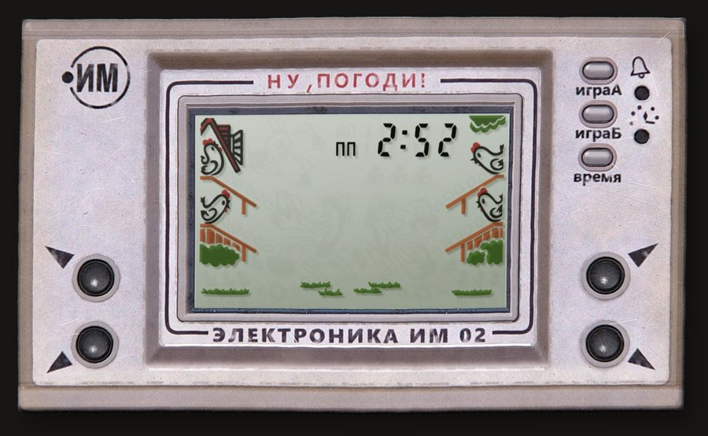
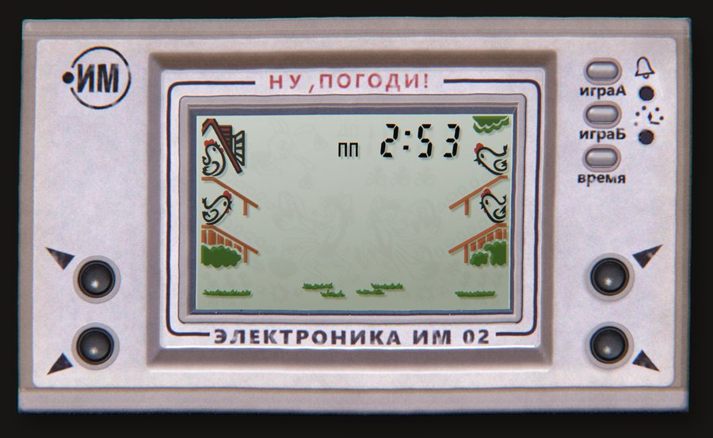
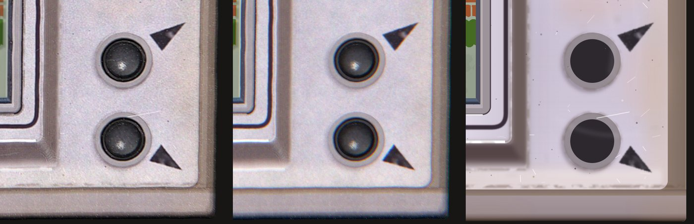
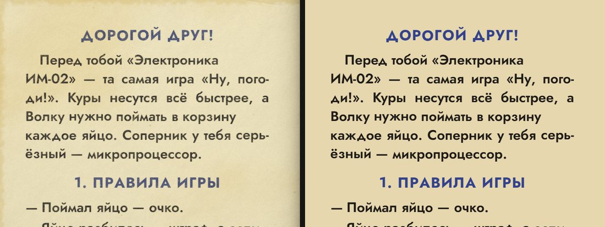

<p align="center">
  
</p>

<h1 align="center">Nu, Pogodi! · Elektronika IM-02</h1>

<p align="center">
  The Soviet LCD handheld from 1984, rebuilt for the browser.<br>
  Same game, same timings, same beeps. Plus a paper manual on the table.
</p>

<p align="center">
  <a href="https://nu-pogodi-im02.vercel.app"></a>
</p>

<p align="center">
  
  
  
  
  
  
  
  
  
</p>

<p align="center">
  <b>English</b> · <a href="README.ru.md">Русский</a>
</p>


## What is this

"Elektronika IM-02 *Nu, Pogodi!*" was the most famous Soviet handheld game. The Wolf from the cartoon *Nu, Pogodi!* ("Just You Wait!") catches eggs rolling down four chutes. Miss three and it's over.

I rebuilt it as a web app for the Kaspersky SafeBoard internship test task (2026):

- **The game plays like the original.** Speed, egg limits, the Hare's timer and sounds are measured from the original ROM, not guessed.
- **The device looks like a photo, but it's not one.** The plastic body, buttons, shadows, scratches and the camera look are all drawn in real time with WebGL. No textures from photos.
- **The start screen is a paper manual.** A worn booklet lies next to the game. You can flip through it: rules, controls, high scores, and a quality-control certificate where your last score gets written in "by pen".
- **No sound files.** Every beep is synthesized on the fly, at the same frequencies as the original chip.
- **It's also a clock with an alarm**, like the real thing.
- **Russian or English.** The manual and the settings speak both, picked from your browser language. The device itself stays Soviet.
- **Works everywhere.** Keyboard, mouse, touch with vibration, gyroscope light on phones. Weak computers get a lighter render, browsers without WebGL get a flat version.



## Controls

| | Keyboard | Mouse / touch |
|---|---|---|
| Wolf, upper left | Q or ← | upper left button |
| Wolf, lower left | A or ↓ | lower left button |
| Wolf, upper right | P or ↑ | upper right button |
| Wolf, lower right | L or → | lower right button |
| Game A / Game B | 1 (Enter) / 2 | buttons on the console or in the booklet |
| Clock | T | "время" button |
| Alarm / set time | 8 / 9 | the two holes on the right |
| Manual | H or ? | panel on the right |
| Sound | M | panel on the right |
| Language | | panel on the right |

Letters work in the Russian layout too. On a phone, turn it sideways.

## Rules

- Catch an egg: +1 point. Drop one: a miss.
- If the Hare is peeking out when an egg breaks, a chick hatches and runs off. That's only half a miss.
- Three misses: game over.
- At 200 and 500 points all misses are cleared.
- The more points, the faster it gets and the more eggs at once (up to six).
- Game A uses three chutes, Game B starts faster on all four.
- After the game the manual opens on your result. Beat the record and it says "new!".


## What's inside

| Part | What I used | What it does |
|---|---|---|
| Game engine | Plain TypeScript, no React | Event-based simulation with ROM timings. Doesn't care about frame rate or lag. |
| Device render | Raw WebGL + GLSL, no libraries | Procedural plastic, lighting, shadows, wear and camera effects. |
| LCD screen | SVG segments + WebGL | 72 real segments with liquid-crystal lag and shadows on the glass. |
| Manual | Canvas 2D + WebGL paper shader + CSS 3D | Paper texture, ink, page flips, my own text layout with Russian hyphenation. |
| Sound | Web Audio | Square-wave beeper, button clicks, paper rustle. |
| UI | React 19 + Less | Console, booklet, settings panel. React only shows state, it doesn't run the game. |
| Tests | Vitest | 49 tests on the engine, clock, scores, hyphenation and more. |
| Hosting | Vercel | Deploys on every push. |

<details>
<summary><b>More details for the curious</b></summary>

### Engine

- `advance(state, dt, random)` jumps from event to event (a chute tick, the end of an animation) instead of stepping frame by frame. Long frames are clamped to 0.1 s.
- The IM-02 runs the same code as the Nintendo Game & Watch *Egg*. The timings were measured in an SM5A CPU emulator. All numbers with sources are in [design/game-spec.md](design/game-spec.md) (in Russian).
- Time and randomness are passed in, so tests are deterministic (Park–Miller generator with a fixed seed).
- The game loop runs on `requestAnimationFrame`, components subscribe through `useSyncExternalStore`.

### Device render

- Albedo, height, material, print and wear maps are built from SVG.
- Two passes: a surface shader for lighting, then a camera shader for the lens.
- Normals from the height map, ray-marched shadows (30 steps, soft penumbra), ambient occlusion, Blinn–Phong highlights.
- Value-noise plastic with sparkles, Voronoi-style scratches, dirt in the recesses, extra wear near the buttons.
- Camera: barrel distortion, chromatic aberration, glow, sensor noise, 8×8 JPEG blocks.
- Only changed regions are redrawn: when the LCD changes or a button moves, the lighting pass is scissored to that area.
- Each of the 15 stages is a `#define`. A disabled stage is compiled out and costs nothing. Presets "Photo", "Clean" and "Fast" are sets of these flags.
- Buttons are damped springs (semi-implicit Euler, 1/480 s substep): a stiff press and a springy release.
- The light follows the mouse or the phone tilt.

### Manual

- Pages are drawn as ink layers (letterpress, stamp, ballpoint pen), then a paper shader puts them on fibrous paper with creases and dog-ears.
- My own typesetter: line breaking, justification, Russian hyphenation by syllables, automatic font size so the text always fits.



### Sound

- One-bit square wave at the ROM frequencies: steps, catch, miss, the running chick, game over, alarm.
- Clicks are a noise burst plus a low thud. Paper rustle is filtered noise.
- Sound starts after the first click, as browsers require. That's why the manual waits closed with "Tap the cover".

### Without a GPU

- Software WebGL is detected and the "Fast" preset turns on.
- No WebGL at all: a flat mode with a static image and DOM segments. Try it anywhere by adding `?flat` to the URL.

| Photo (GPU) | Fast (software WebGL) | Flat (no WebGL) |
|---|---|---|
|  |  |  |





### Changes to the provided boilerplate

- Installed the missing ESLint plugins.
- Production builds now actually run in production mode, with hashed bundles and a clean `dist/`.
- Modern tsconfig (ES2022, `moduleResolution: Bundler`).
- React 17 → 19.
- Added Vitest and `lint`, `format`, `typecheck`, `test`, `check` scripts.
- Webpack loads SVG and GLSL as text and bundles fonts.

</details>

## Run it locally

You need Node.js 22.12+.

```bash
npm ci
npm run dev      # http://localhost:8080
npm run build    # production build in dist/
npm run check    # types, lint, tests
```

Project layout:

```
src/
  game/        engine, clock, high scores, config, tests
  lcd/         screen segments and film
  render/      WebGL device render, shaders, light, table
    paper/     paper shader, typesetter, hyphenation
  audio/       beeper, clicks, paper sounds
  components/  React: console, booklet, settings, loader
design/        ROM spec, art research, render prototype
```

## Credits

- LCD segment outlines: the MAME `nupogodi.svg` layout by Igor and hap, improved by algestam. No licence stated.
- LCD film: traced from `fg.png` of [nupogodi-sdl](https://github.com/artyomsoft/nupogodi-sdl). No licence stated.
- Body reference photo: [Электроника ИМ 02.jpg](https://commons.wikimedia.org/wiki/File:Электроника_ИМ_02.jpg) by Andrey Butko, CC BY-SA 3.0. The body itself is drawn from scratch.
- The manual follows the design of the real 1991 IM-02 manual. Texts are rewritten, the scan is not included.
- Fonts [Jost](https://fonts.google.com/specimen/Jost) and [Caveat](https://fonts.google.com/specimen/Caveat) (SIL OFL 1.1), icons [Fluent UI System Icons](https://github.com/microsoft/fluentui-system-icons) (MIT).
- The Wolf and the Hare belong to Soyuzmultfilm. This is a non-commercial fan project.

## License

Code: MIT, see [LICENSE](LICENSE). Made by Dmitry Troshkin ([@troshkindm](https://github.com/troshkindm)).

The license doesn't cover the third-party materials above or the Kaspersky SafeBoard boilerplate config.
