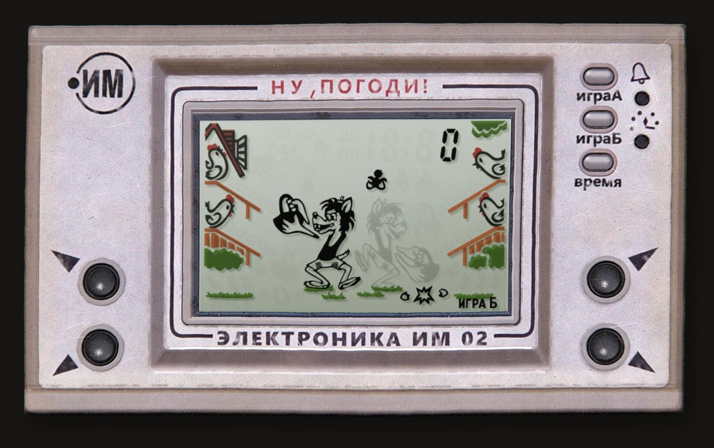
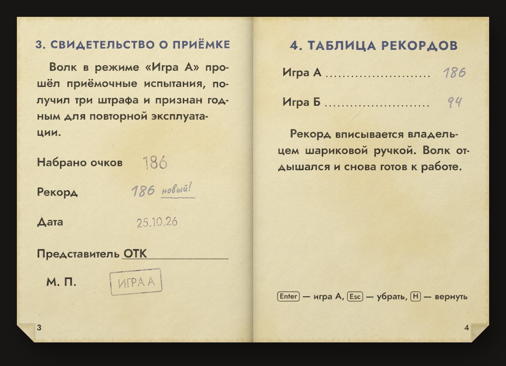
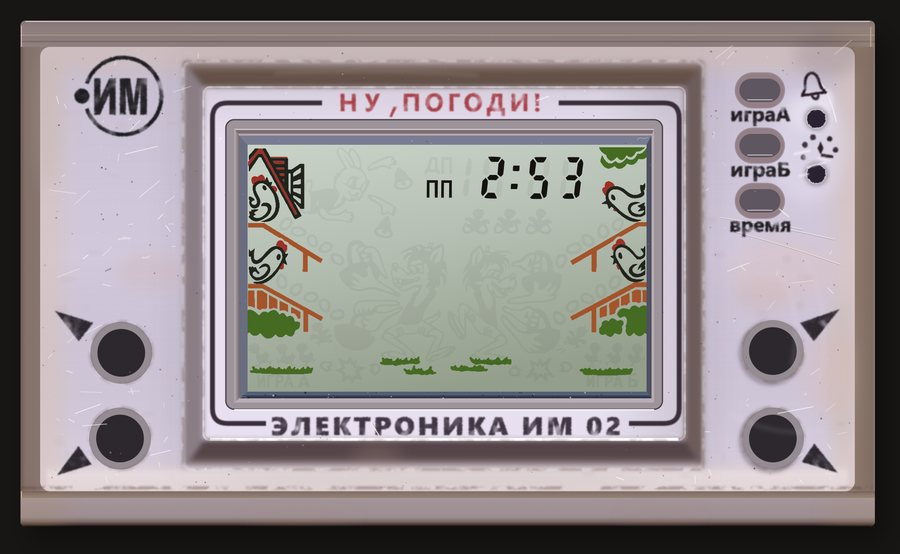

# «Ну, погоди!» — Электроника ИМ-02 в браузере

**Играть онлайн: [nu-pogodi-im02.vercel.app](https://nu-pogodi-im02.vercel.app)**



Веб-версия советской карманной ЖК-игры «Электроника ИМ-02 "Ну, погоди!"» (1984). Механика сверена с оригинальным ROM, корпус и экран рисует WebGL-рендер «под фотографию», а стартовый экран и экран проигрыша — бумажное руководство по эксплуатации, которое лежит рядом с игрой на столе.

Тестовое задание стажировки Kaspersky SafeBoard, 2026. Стек из бойлерплейта: TypeScript, React, Less, Webpack, Vitest.

## Вселенная

Волк из мультфильма стоит между четырьмя курятниками. Куры несутся всё быстрее, яйца катятся по желобам, и Волку нужно поймать в корзину каждое. Из домика в углу время от времени выглядывает Заяц. Пока он смотрит, разбитое яйцо не пропадает: из него вылупляется цыплёнок и убегает.

Игра лежит на столе вместе с потрёпанной книжкой «Руководство по эксплуатации». Книжку можно открыть и полистать. В ней правила, схема управления, «Свидетельство о приёмке», куда ОТК вписывает ручкой итог последней игры, таблица рекордов, гарантийные обязательства и отрывной гарантийный талон, как в настоящем руководстве ИМ-02. Когда игра не идёт, ИМ-02 работает как часы с будильником, как и оригинал.


## Запуск

Нужен Node.js 22.12 или новее.

```bash
npm ci
```

```bash
npm run dev
```

Дев-сервер откроется на http://localhost:8080.

```bash
npm run build
```

Продакшен-сборка в `dist/`.

```bash
npm run check
```

Проверка типов, ESLint и тесты Vitest. `npm run format` проверяет Prettier.

## Как играть

### Правила

- Яйца катятся по четырём желобам, по два с каждой стороны, в каждом пять позиций. Волк держит корзину у одного из желобов. Яйцо скатилось к корзине — одно очко.
- Яйцо упало мимо — разбилось, и загорается значок штрафа. Если в этот момент в окошке виден Заяц, из яйца вылупляется цыплёнок и убегает. Это полштрафа, значок мигает, два полуштрафа дают один целый.
- Заяц появляется по таймеру: пять секунд его нет, пять секунд он виден.
- Три штрафа — игра окончена.
- На 200 и 500 очках все штрафы снимаются. Игра замирает, значки мигают, звучат семь сигналов.
- Скорость растёт с каждым очком, а в начале каждой сотни немного откатывается назад. Чем больше счёт, тем больше яиц одновременно на поле: от одного до шести.
- Максимум 999, дальше счёт идёт с 000 на высокой скорости, штрафы сохраняются.
- «Игра А» использует три желоба из четырёх, какой пустует, зависит от числа штрафов. «Игра Б» стартует быстрее и сразу на всех четырёх.
- Рекорд для каждой игры сохраняется в браузере и попадает в таблицу рекордов в книжке.

После игры книжка открывается на «Свидетельстве о приёмке» с итоговым счётом и пометкой «новый!», если рекорд побит.



### Управление

| Действие | Клавиатура | Мышь и тач |
|---|---|---|
| Волк: левый верхний желоб | Q, ← | левая верхняя круглая кнопка |
| Волк: левый нижний желоб | A, ↓ | левая нижняя круглая кнопка |
| Волк: правый верхний желоб | P, ↑ | правая верхняя круглая кнопка |
| Волк: правый нижний желоб | L, → | правая нижняя круглая кнопка |
| Игра А | 1, Enter | кнопка «игра А» на консоли или в книжке |
| Игра Б | 2 | кнопка «игра Б» на консоли или в книжке |
| Часы | T | кнопка «время» |
| Будильник | 8 | верхняя лунка справа |
| Установка времени | 9 | нижняя лунка справа |
| Открыть книжку | H, ? | кнопка на панели справа |
| Убрать книжку | Esc | клик мимо книжки |
| Листать книжку | PageUp, PageDown | уголки страниц, свайп |
| Звук | M | панель справа |

Буквы работают и в русской раскладке (Й, Ф, З, Д, Е, Р, Ь). На телефоне игра просит повернуть экран горизонтально, зоны касания у кнопок крупнее самих кнопок, а нажатие отдаётся короткой вибрацией.

### Часы и будильник

- «Время» включает часы: двенадцатичасовой формат с ДП/ПП, на экране идёт беззвучное демо Волка.
- «Установка времени»: левые кнопки Волка листают часы, правые — минуты, «Время» запускает часы.
- «Будильник» включает и выключает будильник и показывает его время, кнопки Волка его меняют. Когда будильник включён, в часах виден колокольчик.
- В назначенную минуту Заяц звонит в колокольчик: 2048 Гц раз в секунду в течение минуты, «Время» его останавливает.
- Время и будильник сохраняются в браузере.

### Панель настроек

На панели справа — звук, свет за мышью (на телефоне — от наклона), руководство, полноэкранный режим и настройки. В настройках: звук, источник света (неподвижный, за мышью или по гироскопу), размер консоли (на больших мониторах по умолчанию уменьшается до 80%), пресет картинки и пятнадцать отдельных этапов обработки. Всё сохраняется в браузере.

## Как это устроено

### Движок

`src/game/` — чистый TypeScript без React и DOM.

- **Дискретно-событийная симуляция.** `advance(state, dt, random)` не шагает кадрами, а перескакивает от события к событию: такт желоба, конец анимации промаха, мигание значков. Поэтому результат не зависит от частоты кадров и от лагов, а длинный кадр обрезается до 0.1 с.
- **Тайминги из ROM.** ИМ-02 работает на том же коде, что Nintendo Game & Watch Egg. Такт, обход желобов, лимиты яиц, кривая скорости, заяц-меандр с периодом 5 с и звуки замерены в эмуляторе процессора SM5A. Все числа с источниками — в [design/game-spec.md](design/game-spec.md).
- **Детерминизм.** Время и случайность передаются снаружи. В тестах — генератор Парка — Миллера (48271 · x mod 2³¹ − 1) с фиксированным зерном, в игре — `Math.random`.
- **React не крутит цикл.** Сессия гоняет `requestAnimationFrame` сама, а компоненты подписаны на неё через `useSyncExternalStore`.
- **Часы** — отдельный автомат со смещением от системного времени, режимами установки и будильником.

### Экран

- 72 сегмента ЖКИ и цветная плёнка — векторные SVG. Функции в `src/lcd/segments.ts` переводят состояние игры, часов или загрузчика в набор горящих сегментов.
- Инерция жидких кристаллов: рендер держит прошлый и текущий кадр сегментов и смешивает их, сегмент загорается примерно в четыре раза быстрее, чем гаснет.
- Тень сегментов на подложке: выборка по кольцу из восьми точек со сдвигом, как будто свет проходит через толщину стекла.

### Рендер корпуса

`src/render/` — WebGL без библиотек. Корпус не фотография: он целиком нарисован процедурно.

- **Карты.** Из SVG собираются текстуры альбедо, высот, материала (блеск и шероховатость), печати и износа.
- **Два прохода.** Сначала surface-шейдер освещает поверхность во внеэкранный буфер, затем camera-шейдер добавляет оптику фотоаппарата.
- **Нормали** считаются из карты высот центральными разностями.
- **Тени** — марширование луча по карте высот в сторону источника, 30 шагов, полутень растёт с расстоянием.
- **Затенение в углах** (ambient occlusion) — восемь направлений на двух радиусах.
- **Блики** — модель Блинна — Фонга. Резкость блика берётся из карты материала, второй слабый источник изображает вспышку.
- **Пластик.** Фактура — value noise, искры — редкие ячейки хеш-сетки, которые вспыхивают под светом.
- **Износ.** Царапины — ячеистое поле с поиском по соседним 3×3 клеткам, в духе шума Вороного. Грязь собирается в углублениях, у кнопок пластик затёрт сильнее.
- **Неровные кромки и печать** — доменное искажение шумом, чтобы края не были идеально векторными.
- **Камера.** Бочкообразная дисторсия, хроматическая аберрация, мягкость с нерезким маскированием, ореол на светлом, шум матрицы (яркостный и цветовые пятна) и блоки JPEG 8×8.
- **Перерисовка по областям.** Кадр целиком считается только при старте, смене настроек и движении света. Когда меняется экран ЖКИ или нажимается кнопка, проход освещения ограничен ножницами (scissor) по прямоугольнику экрана или кнопки с запасом на тени. Проход камеры захватывает ещё 56 px вокруг, чтобы учесть ореол и дисторсию. Внутри экрана шейдер считает только тень, затенение и цвет ЖКИ, а опрос высоты кнопок пропускает для пикселей, до которых не дотягиваются их тени. Сегменты рисуются через Canvas 2D и загружаются в текстуру только областью экрана.
- **Этапы через `#define`.** Каждый из пятнадцати этапов — флаг препроцессора. Шейдер пересобирается только с включёнными этапами, выключенный этап ничего не стоит. Пресеты «Фото», «Чистая» и «Быстрая» — наборы этих флагов (`src/render/settings.ts`).
- **Кнопки.** Каждая кнопка — пружина с демпфером, интегрируется полунеявным методом Эйлера с подшагом 1/480 с. Нажатие жёсткое, отпускание упругое, с лёгким отскоком.
- **Свет** следует за мышью или наклоном телефона с экспоненциальным сглаживанием (постоянная 320 мс). Гироскоп учитывает поворот экрана, на iOS запрашивается разрешение.

### Книжка

`src/render/paper/` и `src/components/Booklet/`.

- **Страница** рисуется на canvas слоями краски: типографская печать, штамп и шариковая ручка. Затем WebGL-шейдер бумаги собирает из них итоговую страницу.
- **Бумага.** Рельеф волокон — фрактальный шум (fbm, 5 октав), плюс заломы, изгиб у корешка и загнутые уголки. Освещение двумя источниками, тональная компрессия и шум камеры.
- **Краска.** Растекание по волокнам (выборка по кругу), пропуски краски в печати, неравномерный оттиск штампа, глянцевый след ручки, потёртости на обложке.
- **Свой типограф.** Жадное разбиение на строки с переносом слова по слогам, выключка по ширине (пробел растягивается не больше чем в 2.4 раза, иначе строка остаётся влево), висячие списки, легенды. Кегль подбирается автоматически: вёрстка пробно прогоняется на крошечном холсте с масштабами от 1.3 до 0.82, берётся самый крупный, при котором текст влезает.
- **Русские переносы** по правилам слогов: гласная–согласная–гласная, стык согласных, Й, Ь и Ъ не отрываются, не меньше двух букв в каждой части.
- **Листы** — CSS 3D с переворотом. Работают клики по уголкам, свайпы и PageUp/PageDown.


### Звук

`src/audio/` — WebAudio, без звуковых файлов.

- Однобитный меандр на частотах из ROM: шаг яиц, поимка, промах, бег цыплёнка, трель конца игры, будильник.
- Щелчок кнопки: короткий шумовой импульс и глухой низкий «тук».
- Бумага: полосовой шум со скользящей частотой и случайной огибающей для шелеста, хлопок листа через фильтр низких частот, мягкий удар, когда книжка ложится на стол.
- Звук включается после первого касания или клика, как требует политика автозапуска браузеров. Поэтому книжка сначала лежит закрытой с подсказкой «Нажми на обложку».

### Остальное

- **Стол** — процедурная текстура: value noise из четырёх октав в бесшовном тайле 384 px.
- **Загрузчик** — экран ЖКИ с бегущими яйцами, пока грузятся шрифты, текстуры и шейдеры.
- **Конфиги.** Все настраиваемые числа в одном месте: тайминги, кривая скорости, лимиты яиц, звуки и клавиши в `src/game/config.ts`, этапы рендера в `src/render/settings.ts`, свет в `src/render/lighting.ts`.
- **Хранение.** Рекорды, настройки и часы лежат в `localStorage`, при чтении всё проверяется. Испорченные данные не ломают игру.
- **Тесты.** 47 тестов Vitest: движок (такты, скорость, штрафы, заяц, бонусы), часы, рекорды, раскладка сегментов, области перерисовки, пружина кнопок, настройки, переносы.

## Рендер без видеокарты

Картинка рассчитана на видеокарту. Без неё игра работает, но выглядит условно иначе.

- **Программный WebGL** (SwiftShader, llvmpipe и подобные, определяется через `WEBGL_debug_renderer_info`). Автоматически включается пресет «Быстрая»: без теней, затенения в углах, износа, мягкости объектива и ореола. Вернуть «Фото» можно в настройках, если компьютер тянет.
- **WebGL недоступен.** Включается плоский режим: корпус — статичная картинка из той же SVG-карты альбедо, без света и рельефа, экран — обычные DOM-сегменты, страницы книжки — 2D-canvas без шейдера бумаги.
- Плоский режим можно посмотреть и на любом компьютере: добавьте `?flat` к адресу.

| Фото (видеокарта) | Быстрая (программный WebGL) | Плоский (без WebGL) |
|---|---|---|
|  |  |  |

Те же три режима вблизи:


Страница книжки с шейдером бумаги и без него:


## Что изменено в бойлерплейте

- ESLint ссылался на неустановленные плагины, они доустановлены. Версия React определяется автоматически.
- Сборка всегда шла в режиме development. Теперь режим задаётся через `--mode`, в продакшене у бандла хеш в имени, а `dist/` очищается.
- tsconfig: библиотеки ES2022 и DOM.Iterable вместо ES5, модули ESNext, `moduleResolution: Bundler`, `noEmit`.
- React 17 → 19 с `createRoot`.
- Добавлены Vitest и скрипты `lint`, `format`, `typecheck`, `test`, `check`.
- В Webpack добавлены загрузка файлов как текста через `?raw` (SVG и GLSL) и шрифты.

## Структура

```
src/
  game/        движок: игра, часы, рекорды, конфиг, тесты
  lcd/         сегменты и плёнка экрана, состояние → горящие сегменты
  render/      WebGL-рендер корпуса, шейдеры, карты, свет, стол
    paper/     шейдер бумаги, типограф, переносы, слои краски
  audio/       пищалка, щелчки, звуки бумаги
  components/  React: консоль, книжка, панель настроек, загрузчик
design/        спецификация механики по ROM, исследование арта, прототип рендера
docs/          скриншоты для README
```

## Источники и атрибуция

- Контуры сегментов экрана (`src/lcd/segments.svg`) взяты из векторной раскладки эмулятора MAME `nupogodi.svg`: обводка скана настоящего экрана ИМ-02, авторы Igor и hap, улучшения algestam. Лицензия авторами не указана.
- Плёнка экрана (`src/lcd/film.svg`) обведена по слоям цвета с картинки-оверлея `fg.png` проекта [nupogodi-sdl](https://github.com/artyomsoft/nupogodi-sdl). Автор и лицензия картинки не указаны.
- Эталон для фотореалистичного корпуса — фото [Электроника ИМ 02.jpg](https://commons.wikimedia.org/wiki/File:Электроника_ИМ_02.jpg) (Andrey Butko, CC BY-SA 3.0). Сам корпус нарисован процедурно.
- Книжка-руководство свёрстана заново по образцу настоящего «Руководства по эксплуатации» ИМ-02 (1991): оформление, разделы «Свидетельство о приёмке», «Гарантийные обязательства» и отрывной талон. Тексты написаны заново, скан в проект не входит.
- Шрифты [Jost](https://fonts.google.com/specimen/Jost) и [Caveat](https://fonts.google.com/specimen/Caveat) — SIL Open Font License 1.1, подключены через Fontsource.
- Иконки панели — [Fluent UI System Icons](https://github.com/microsoft/fluentui-system-icons) (Microsoft, MIT).
- Тайминги и правила сняты с оригинального ROM, подробности и источники в `design/game-spec.md`.
- Волк и заяц — персонажи мультфильма «Ну, погоди!» («Союзмультфильм»). Проект некоммерческий, сделан как тестовое задание.

## Лицензия

Тестовое задание стажировки Kaspersky SafeBoard, 2026. Код проекта распространяется по лицензии MIT, см. [LICENSE](LICENSE). Автор — Дмитрий Трошкин ([github.com/troshkindm](https://github.com/troshkindm)).

Лицензия не распространяется на сторонние материалы из раздела выше: векторы сегментов MAME, плёнку из nupogodi-sdl, эталонные фото, шрифты и иконки (у них свои лицензии), персонажей мультфильма «Ну, погоди!» и конфигурацию из бойлерплейта Kaspersky SafeBoard.
