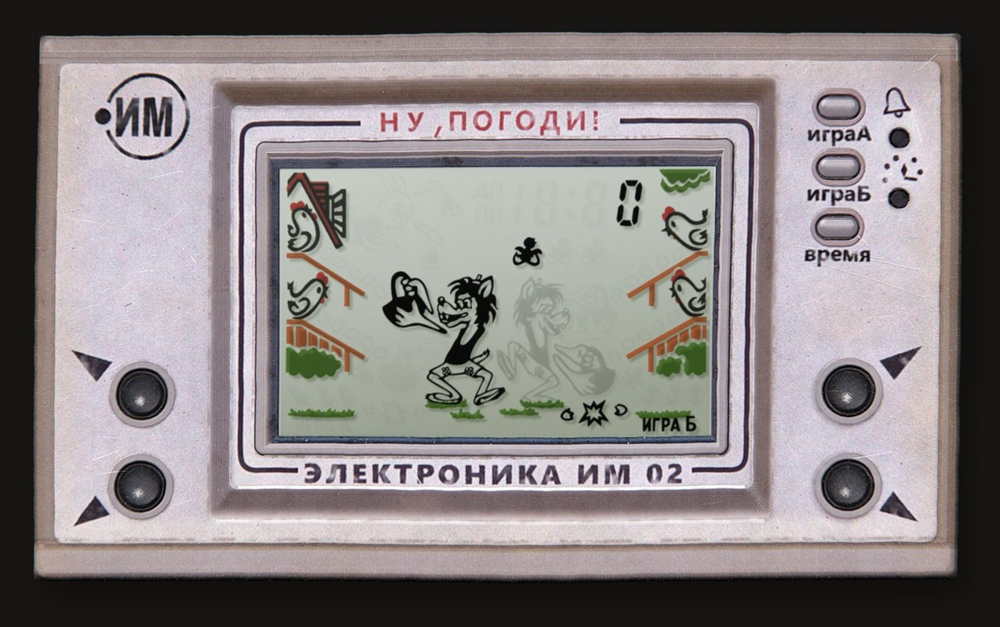
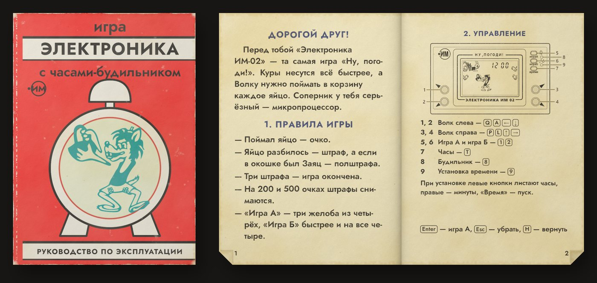
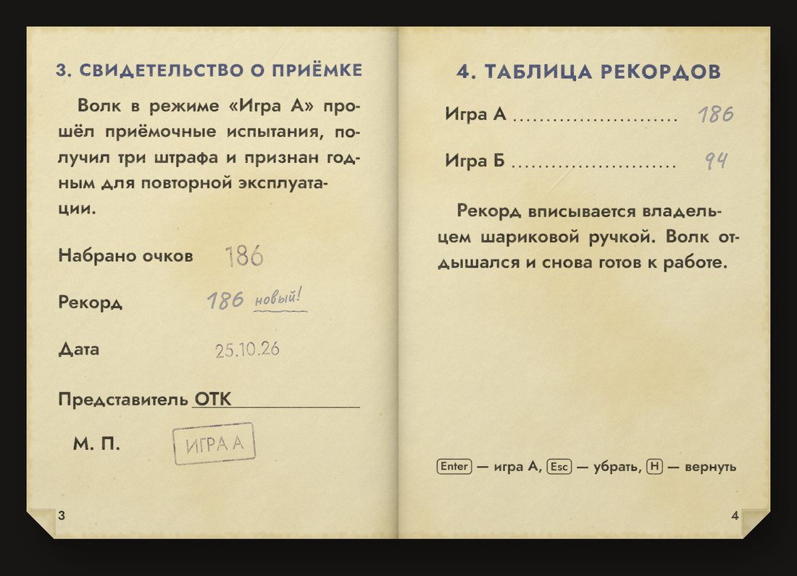
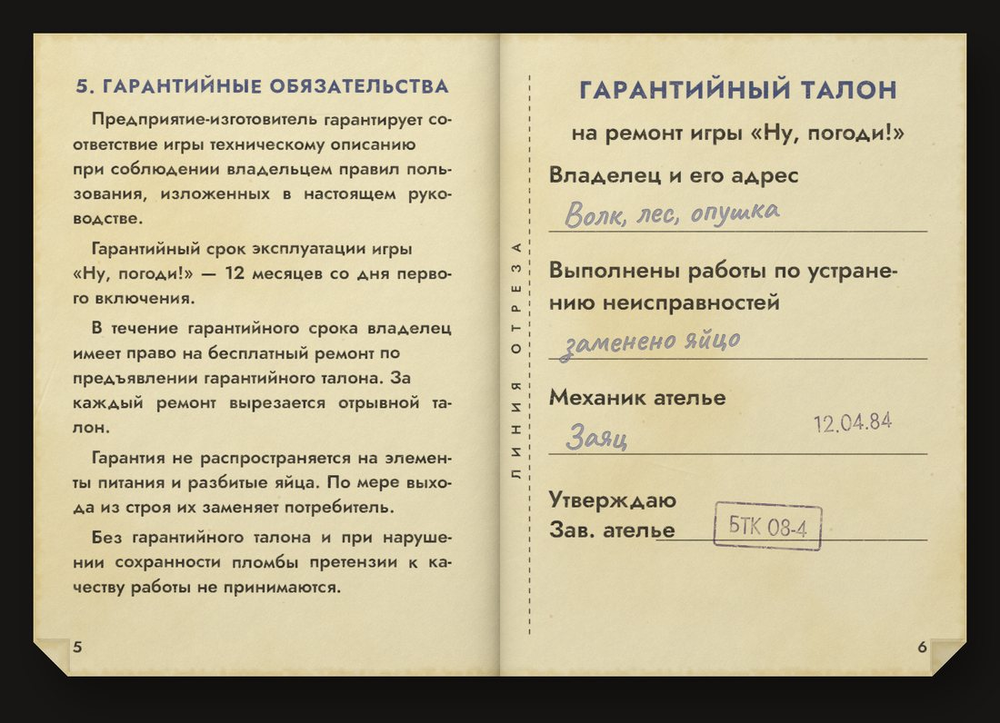
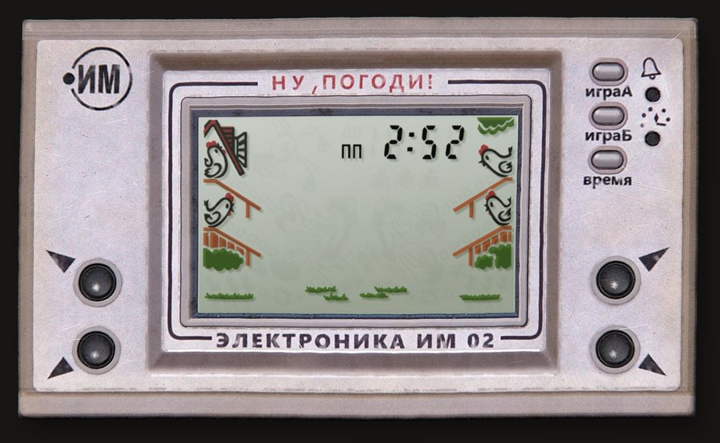
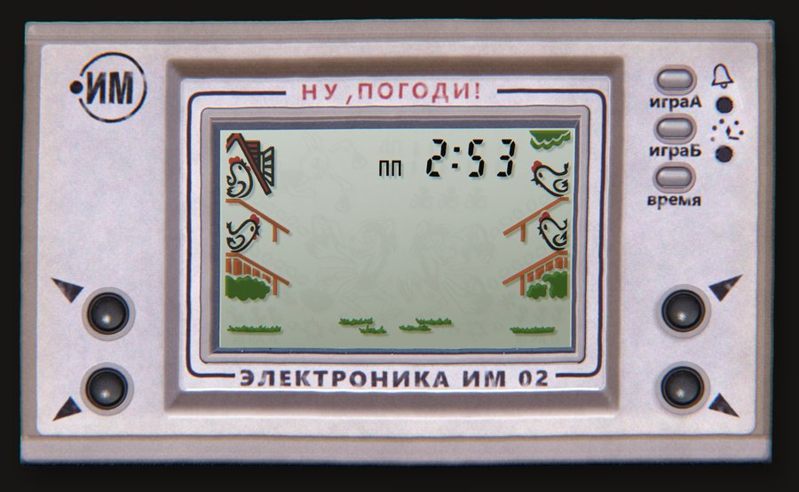
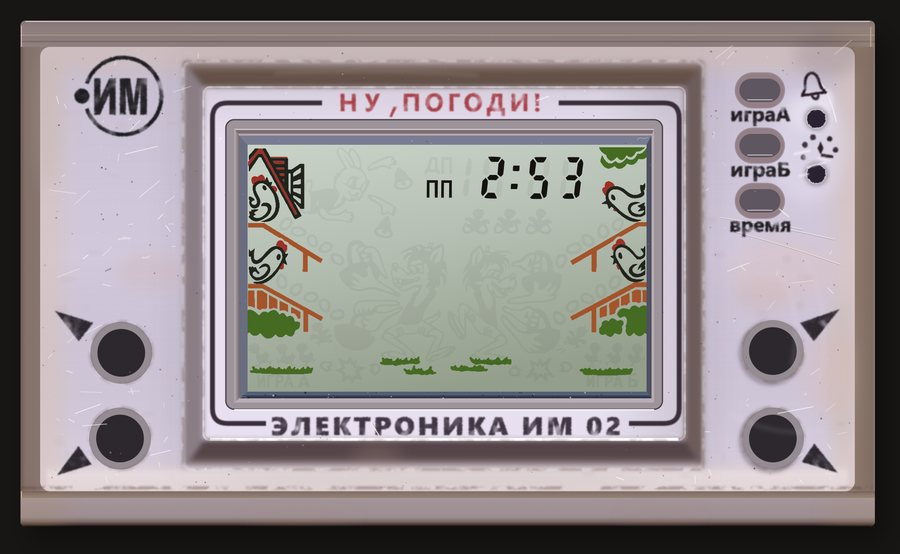
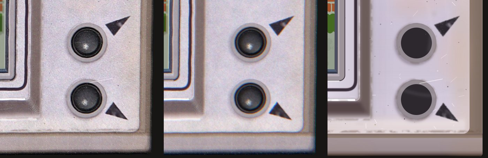
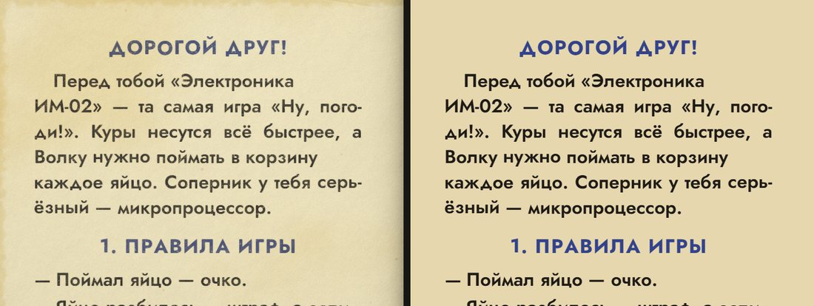

<p align="center">
  
</p>

<h1 align="center">«Ну, погоди!» · Электроника ИМ-02</h1>

<p align="center">
  Советская ЖК-игра 1984 года, пересобранная для браузера.<br>
  Та же игра, те же тайминги, те же пищалки. И бумажная инструкция на столе.
</p>

<p align="center">
  <a href="https://nu-pogodi-im02.vercel.app"></a>
</p>

<p align="center">
  
  
  
  
  
  
  
  
  
</p>

<p align="center">
  <a href="README.md">English</a> · <b>Русский</b>
</p>



## Что это

«Электроника ИМ-02 "Ну, погоди!"» — та самая игра, где Волк ловит яйца в корзину. Яйца катятся по четырём желобам, три промаха — конец.

Я сделал её веб-версию как тестовое задание стажировки Kaspersky SafeBoard (2026):

- **Играется как оригинал.** Скорость, лимиты яиц, таймер Зайца и звуки сняты с оригинального ROM, а не подобраны на глаз.
- **Корпус выглядит как фото, но это не фото.** Пластик, кнопки, тени, царапины и эффект фотоаппарата рисуются на WebGL в реальном времени. Ни одной фототекстуры.
- **Стартовый экран — бумажная инструкция.** Рядом с игрой лежит потрёпанная книжка. Её можно листать: правила, управление, рекорды и «Свидетельство о приёмке», куда ОТК «ручкой» вписывает счёт последней игры.
- **Ни одного звукового файла.** Каждый писк синтезируется на лету, на тех же частотах, что у оригинального чипа.
- **Ещё это часы с будильником**, как настоящая ИМ-02.
- **Русский или английский.** Инструкция и настройки говорят на обоих, язык берётся из браузера. Сам корпус остаётся советским.
- **Работает везде.** Клавиатура, мышь, тач с вибрацией, свет от гироскопа на телефоне. Слабым компьютерам — облегчённый рендер, браузерам без WebGL — плоская версия.



## Управление

| | Клавиатура | Мышь / тач |
|---|---|---|
| Волк, левый верх | Q или ← | левая верхняя кнопка |
| Волк, левый низ | A или ↓ | левая нижняя кнопка |
| Волк, правый верх | P или ↑ | правая верхняя кнопка |
| Волк, правый низ | L или → | правая нижняя кнопка |
| Игра А / Игра Б | 1 (Enter) / 2 | кнопки на консоли или в книжке |
| Часы | T | кнопка «время» |
| Будильник / установка времени | 8 / 9 | две лунки справа |
| Инструкция | H или ? | панель справа |
| Звук | M | панель справа |
| Язык | | панель справа |

Буквы работают и в русской раскладке. Телефон держи горизонтально.

## Правила

- Поймал яйцо — +1 очко. Уронил — штраф.
- Если в момент падения выглядывает Заяц, из яйца вылупляется цыплёнок и убегает. Это только полштрафа.
- Три штрафа — игра окончена.
- На 200 и 500 очках штрафы сгорают.
- Чем больше очков, тем быстрее и тем больше яиц сразу (до шести).
- Игра А — три желоба, Игра Б — быстрее и сразу все четыре.
- После игры книжка открывается на результате. Побил рекорд — там будет «новый!».



## Что внутри

| Часть | Чем сделано | Что делает |
|---|---|---|
| Движок игры | Чистый TypeScript, без React | Событийная симуляция с таймингами из ROM. Не зависит от частоты кадров и лагов. |
| Рендер корпуса | Голый WebGL + GLSL, без библиотек | Процедурный пластик, свет, тени, износ, эффекты камеры. |
| Экран ЖКИ | SVG-сегменты + WebGL | 72 настоящих сегмента с инерцией кристаллов и тенью на стекле. |
| Инструкция | Canvas 2D + шейдер бумаги + CSS 3D | Бумага, краска, перелистывание, свой типограф с русскими переносами. |
| Звук | Web Audio | Меандр-пищалка, щелчки кнопок, шелест бумаги. |
| Интерфейс | React 19 + Less | Консоль, книжка, панель настроек. React только показывает состояние, игру он не крутит. |
| Тесты | Vitest | 49 тестов: движок, часы, рекорды, переносы и остальное. |
| Хостинг | Vercel | Деплой на каждый пуш. |

<details>
<summary><b>Подробнее для любопытных</b></summary>

### Движок

- `advance(state, dt, random)` прыгает от события к событию (такт желоба, конец анимации), а не шагает по кадрам. Длинный кадр обрезается до 0.1 с.
- ИМ-02 работает на том же коде, что Nintendo Game & Watch *Egg*. Тайминги замерены в эмуляторе процессора SM5A. Все числа с источниками — в [design/game-spec.md](design/game-spec.md).
- Время и случайность передаются снаружи, поэтому тесты детерминированы (генератор Парка — Миллера с фиксированным зерном).
- Цикл крутится на `requestAnimationFrame`, компоненты подписаны через `useSyncExternalStore`.

### Рендер корпуса

- Из SVG собираются карты цвета, высот, материала, печати и износа.
- Два прохода: шейдер поверхности для света, потом шейдер камеры для оптики.
- Нормали из карты высот, тени маршированием луча (30 шагов, мягкая полутень), затенение в углах, блики по Блинну — Фонгу.
- Пластик на value noise с искрами, царапины в духе шума Вороного, грязь в углублениях, затёртость у кнопок.
- Камера: бочкообразная дисторсия, хроматическая аберрация, ореол, шум матрицы, блоки JPEG 8×8.
- Перерисовываются только изменённые области: если поменялся экран или нажата кнопка, свет считается только в этом прямоугольнике.
- Каждый из 15 этапов — `#define`. Выключенный этап вырезается из шейдера и ничего не стоит. Пресеты «Фото», «Чистая» и «Быстрая» — наборы этих флагов.
- Кнопки — пружины с демпфером (полунеявный Эйлер, шаг 1/480 с): жёсткое нажатие, упругое отпускание.
- Свет ходит за мышью или наклоном телефона.

### Инструкция

- Страница рисуется слоями краски (типография, штамп, шариковая ручка), потом шейдер кладёт их на волокнистую бумагу с заломами и загнутыми уголками.
- Свой типограф: разбиение на строки, выключка по ширине, русские переносы по слогам, автоподбор кегля, чтобы текст всегда влезал.



### Звук

- Однобитный меандр на частотах из ROM: шаги, поимка, промах, бег цыплёнка, конец игры, будильник.
- Щелчок — шумовой импульс и низкий «тук». Шелест бумаги — фильтрованный шум.
- Звук включается после первого клика, так требуют браузеры. Поэтому книжка сначала лежит закрытой с подсказкой «Нажми на обложку».

### Без видеокарты

- Программный WebGL определяется сам, и включается пресет «Быстрая».
- WebGL нет совсем — плоский режим со статичной картинкой и DOM-сегментами. Посмотреть можно где угодно: добавь `?flat` к адресу.

| Фото (видеокарта) | Быстрая (программный WebGL) | Плоский (без WebGL) |
|---|---|---|
|  |  |  |





### Что поменял в бойлерплейте

- Доустановил недостающие плагины ESLint.
- Продакшен-сборка теперь правда продакшен: хеш в имени бандла, `dist/` чистится.
- Современный tsconfig (ES2022, `moduleResolution: Bundler`).
- React 17 → 19.
- Добавил Vitest и скрипты `lint`, `format`, `typecheck`, `test`, `check`.
- Webpack грузит SVG и GLSL как текст и собирает шрифты.

</details>

## Запуск у себя

Нужен Node.js 22.12+.

```bash
npm ci
npm run dev      # http://localhost:8080
npm run build    # продакшен-сборка в dist/
npm run check    # типы, линтер, тесты
```

Структура:

```
src/
  game/        движок, часы, рекорды, конфиг, тесты
  lcd/         сегменты и плёнка экрана
  render/      WebGL-рендер корпуса, шейдеры, свет, стол
    paper/     шейдер бумаги, типограф, переносы
  audio/       пищалка, щелчки, звуки бумаги
  components/  React: консоль, книжка, настройки, загрузчик
design/        спецификация по ROM, исследование арта, прототип рендера
```

## Источники

- Контуры сегментов: векторная раскладка MAME `nupogodi.svg`, авторы Igor и hap, улучшения algestam. Лицензия не указана.
- Плёнка экрана: обведена по `fg.png` из [nupogodi-sdl](https://github.com/artyomsoft/nupogodi-sdl). Лицензия не указана.
- Эталонное фото корпуса: [Электроника ИМ 02.jpg](https://commons.wikimedia.org/wiki/File:Электроника_ИМ_02.jpg), Andrey Butko, CC BY-SA 3.0. Сам корпус нарисован с нуля.
- Инструкция свёрстана по образцу настоящего руководства ИМ-02 1991 года. Тексты написаны заново, скан в проект не входит.
- Шрифты [Jost](https://fonts.google.com/specimen/Jost) и [Caveat](https://fonts.google.com/specimen/Caveat) (SIL OFL 1.1), иконки [Fluent UI System Icons](https://github.com/microsoft/fluentui-system-icons) (MIT).
- Волк и Заяц принадлежат «Союзмультфильму». Проект некоммерческий, фанатский.

## Лицензия

Код — MIT, см. [LICENSE](LICENSE). Автор — Дмитрий Трошкин ([@troshkindm](https://github.com/troshkindm)).

Лицензия не распространяется на сторонние материалы выше и на конфигурацию из бойлерплейта Kaspersky SafeBoard.
